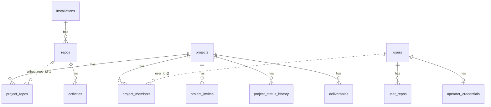

# 데이터 모델

RepoScope는 PostgreSQL 하나에 두 영역의 테이블을 둔다. 수집·계정 영역은 GitHub 활동과 사용자를, `capstone` 스키마는 프로젝트 운영 데이터를 저장한다. 기능 번호는 [기능 명세](feature-spec.md)를 따른다.

## 1. 공통 규칙

- 시각은 `timestamptz`로 UTC를 저장한다.
- 저장소는 이름이 아니라 GitHub 숫자 ID로 식별한다.
- `capstone` 테이블은 수집·계정 테이블에 외래 키를 걸지 않고 ID 값만 저장한다. 두 영역을 따로 운영할 수 있게 하기 위해서다.
- `capstone` 안의 테이블끼리는 외래 키를 건다.
- 스키마 이름은 환경 변수로 받는다.
- 코드, diff, 커밋 작성자 이메일, 커밋 본문, PR·이슈 본문, GitHub 토큰은 저장하지 않는다.

## 2. 테이블 소유

| 테이블 | 쓰는 쪽 | 읽는 쪽 |
|---|---|---|
| `installations`, `repos`, `activities`, `processed_deliveries`, `backfill_jobs` | worker | API |
| `users`, `user_repos` | API | API |
| `operator_credentials`, `operator_sessions`, `login_attempts` | API | API |
| `capstone` 테이블 | API | API |

API는 worker 소유 테이블에 쓰지 않는다. worker는 `capstone` 테이블을 읽거나 쓰지 않는다.

## 3. 관계



점선은 외래 키 없이 값으로만 연결하는 관계다.

## 4. `capstone` 스키마

### `projects`

프로젝트 기본정보를 저장한다. (R-3, R-5, R-11)

| 컬럼 | 타입 | 제약 | 설명 |
|---|---|---|---|
| `id` | `bigserial` | PK | |
| `name` | `text` | NOT NULL, 1~100자 | 이름 |
| `team_name` | `text` | 50자 이하 | 팀 이름 |
| `description` | `text` | 500자 이하 | 설명 |
| `starts_on` | `date` | | 시작일 |
| `ends_on` | `date` | `starts_on` 이후 | 종료일 |
| `status` | `text` | NOT NULL, 기본값 `PLANNING` | 진행 상태 |
| `visibility` | `text` | NOT NULL, 기본값 `TEAM` | 공개 범위. `TEAM`(팀원에게만), `STUDENTS`(학생 모두) |
| `program_id` | `bigint` | | 학기 분류 값 |
| `archived_at` | `timestamptz` | | 보관 시각. `NULL`이면 사용 중 |
| `created_by` | `bigint` | NOT NULL | 등록자 `users.id` 값 |
| `created_at` | `timestamptz` | NOT NULL | |
| `updated_at` | `timestamptz` | NOT NULL | |

| `status` 값 | 화면 표시 |
|---|---|
| `PLANNING` | 기획 |
| `DEVELOPMENT` | 개발 |
| `VERIFICATION` | 검증 |
| `DONE` | 완료 |

### `project_members`

프로젝트 참여자와 역할을 저장한다. (R-4)

| 컬럼 | 타입 | 제약 | 설명 |
|---|---|---|---|
| `project_id` | `bigint` | PK, FK | |
| `user_id` | `bigint` | PK | `users.id` 값 |
| `role` | `text` | NOT NULL, `LEADER` 또는 `MEMBER` | 프로젝트 역할 |
| `joined_at` | `timestamptz` | NOT NULL | |
| `removed_at` | `timestamptz` | | 제외 시각. `NULL`이면 참여 중 |

- 제외한 팀원의 행은 지우지 않고 `removed_at`을 기록한다. 다시 참여하면 `removed_at`을 비우고 `joined_at`을 갱신한다.
- 프로젝트에 팀장이 한 명 이상 남는지는 같은 트랜잭션에서 검사한다.

### `project_invites`

팀원 초대 코드를 저장한다. (R-4)

| 컬럼 | 타입 | 제약 | 설명 |
|---|---|---|---|
| `id` | `bigserial` | PK | |
| `project_id` | `bigint` | NOT NULL, FK | |
| `code_hash` | `text` | NOT NULL, UNIQUE | 초대 코드의 해시 |
| `created_by` | `bigint` | NOT NULL | 발급자 `users.id` 값 |
| `created_at` | `timestamptz` | NOT NULL | |
| `expires_at` | `timestamptz` | NOT NULL | 발급 후 7일 |
| `revoked_at` | `timestamptz` | | 무효 처리 시각 |

- 프로젝트별로 `revoked_at`이 `NULL`인 행은 하나만 허용한다. 부분 유니크 인덱스로 보장한다.
- 원본 코드는 저장하지 않으므로 발급 직후에만 표시한다.

### `project_status_history`

진행 상태 변경 이력을 저장한다. (R-5)

| 컬럼 | 타입 | 제약 | 설명 |
|---|---|---|---|
| `id` | `bigserial` | PK | |
| `project_id` | `bigint` | NOT NULL, FK | |
| `from_status` | `text` | | 이전 상태. 등록 시 `NULL` |
| `to_status` | `text` | NOT NULL | 새 상태 |
| `changed_by` | `bigint` | NOT NULL | 변경자 `users.id` 값 |
| `memo` | `text` | | 선택 메모 |
| `changed_at` | `timestamptz` | NOT NULL | |

### `deliverables`

결과물 링크를 저장한다. (R-6)

| 컬럼 | 타입 | 제약 | 설명 |
|---|---|---|---|
| `id` | `bigserial` | PK | |
| `project_id` | `bigint` | NOT NULL, FK | |
| `kind` | `text` | NOT NULL | 종류 |
| `title` | `text` | NOT NULL, 1~100자 | 제목 |
| `url` | `text` | NOT NULL, `https://`로 시작 | 링크 |
| `created_by` | `bigint` | NOT NULL | 등록자 `users.id` 값 |
| `created_at` | `timestamptz` | NOT NULL | |
| `updated_at` | `timestamptz` | NOT NULL | |

| `kind` 값 | 화면 표시 |
|---|---|
| `DOCUMENT` | 문서 |
| `SLIDES` | 발표자료 |
| `DEMO_VIDEO` | 시연 영상 |
| `REPOSITORY` | 저장소 |
| `OTHER` | 기타 |

### `project_repos`

프로젝트와 저장소의 연결을 저장한다. (R-7)

| 컬럼 | 타입 | 제약 | 설명 |
|---|---|---|---|
| `id` | `bigserial` | PK | |
| `project_id` | `bigint` | NOT NULL, FK | |
| `github_repo_id` | `bigint` | NOT NULL | `repos.repo_id` 값 |
| `linked_by` | `bigint` | NOT NULL | 연결한 `users.id` 값 |
| `linked_at` | `timestamptz` | NOT NULL | |
| `unlinked_at` | `timestamptz` | | 연결 해제 시각 |
| `is_primary` | `boolean` | NOT NULL, 기본값 `false` | 대표 저장소 여부 |

- 저장소별로 `unlinked_at`이 `NULL`인 행은 하나만 허용한다. 부분 유니크 인덱스로 보장한다.
- 프로젝트별로 `is_primary`가 `true`이고 `unlinked_at`이 `NULL`인 행은 하나만 허용한다.
- 연결 해제된 저장소의 활동은 `unlinked_at` 이전까지만 프로젝트에 표시한다.

### `audit_logs`

운영자의 프로젝트 관리 작업을 저장한다.

| 컬럼 | 타입 | 제약 | 설명 |
|---|---|---|---|
| `id` | `bigserial` | PK | |
| `actor_user_id` | `bigint` | NOT NULL | 작업자 `users.id` 값 |
| `action` | `text` | NOT NULL | 작업 코드 |
| `target` | `text` | NOT NULL | 대상. 예: `project:12` |
| `at` | `timestamptz` | NOT NULL | |

## 5. 수집 영역

수집·계정 마이그레이션은 연계 프로젝트(2026URP) 계약을 그대로 따르므로 `teams`, `team_members`, `projects`, `programs`, `audit_logs` 테이블과 `installations.team_id`, `repos.project_id`, `repos.program_id` 컬럼도 만든다. 계약 유지용이며 사용하지 않는다.

### `installations`

GitHub App 설치를 저장한다.

| 컬럼 | 타입 | 설명 |
|---|---|---|
| `installation_id` | `bigint` PK | GitHub 설치 ID |
| `account_login`, `account_id` | `text`, `bigint` | 설치 계정 |
| `account_type` | `text` | `User`, `Organization` |
| `repo_selection` | `text` | `all`, `selected` |
| `status` | `text` | `ACTIVE`, `SUSPENDED`, `REMOVED` |
| `installed_at`, `removed_at` | `timestamptz` | 설치·제거 시각 |

### `repos`

설치된 저장소를 저장한다.

| 컬럼 | 타입 | 설명 |
|---|---|---|
| `repo_id` | `bigint` PK | GitHub 저장소 ID |
| `installation_id` | `bigint` FK | 설치 ID |
| `full_name` | `text` | `owner/name`. 표시용이고 바뀔 수 있다 |
| `is_private` | `boolean` | 비공개 여부 |
| `status` | `text` | `LINKED`, `UNLINKED` |
| `last_synced_at` | `timestamptz` | 마지막 설치 이벤트 시각 |

### `activities`

커밋, PR, 이슈, 리뷰를 저장한다. `(repo_id, kind, ref)`는 UNIQUE다.

| 컬럼 | 타입 | 설명 |
|---|---|---|
| `id` | `bigserial` PK | |
| `repo_id` | `bigint` FK | GitHub 저장소 ID |
| `kind` | `text` | `COMMIT`, `PR`, `ISSUE`, `REVIEW` |
| `ref` | `text` | 커밋은 SHA, PR·이슈는 번호, 리뷰는 리뷰 ID |
| `parent_ref` | `text` | 리뷰가 속한 PR 번호. 리뷰가 아니면 `NULL` |
| `actor_github_id` | `bigint` | 작성자 GitHub ID. 비어 있을 수 있다 |
| `actor_login` | `text` | 작성자 로그인 이름 |
| `title` | `text` | 제목. 커밋은 메시지 첫 줄, 리뷰는 `NULL` |
| `state` | `text` | PR은 `open`, `closed`, `merged`. 이슈는 `open`, `closed`. 리뷰는 `approved`, `changes_requested`, `commented`, `dismissed` |
| `occurred_at` | `timestamptz` | 커밋 시각, PR·이슈 생성 시각, 리뷰 제출 시각 |
| `merged_at` | `timestamptz` | PR 병합 시각. PR이 아니면 `NULL` |
| `url` | `text` | GitHub 링크 |

### `processed_deliveries`

처리한 Webhook을 저장해 중복을 막는다.

| 컬럼 | 타입 | 설명 |
|---|---|---|
| `delivery_id` | `text` PK | `X-GitHub-Delivery` 값 |
| `event` | `text` | 이벤트 이름 |
| `received_at`, `processed_at` | `timestamptz` | 수신·처리 시각 |
| `status` | `text` | `PROCESSED`, `IGNORED`, `FAILED` |

### `backfill_jobs`

저장소별 과거 기록 가져오기 작업을 저장한다.

| 컬럼 | 타입 | 설명 |
|---|---|---|
| `repo_id` | `bigint` PK | GitHub 저장소 ID |
| `status` | `text` | `PENDING`, `DONE`, `SKIPPED`, `FAILED` |
| `since` | `timestamptz` | 이 시각 이후만 가져온다. `NULL`이면 전체 |
| `attempts`, `next_attempt_at` | `integer`, `timestamptz` | 재시도 정보 |
| `items`, `last_error` | `integer`, `text` | 결과 건수, 실패 원인 코드 |
| `requested_at`, `finished_at` | `timestamptz` | 요청·종료 시각 |

## 6. 계정 영역

### `users`

학생과 운영자를 저장한다. (R-1, R-2, R-10)

| 컬럼 | 타입 | 제약 | 설명 |
|---|---|---|---|
| `id` | `bigserial` | PK | |
| `github_id` | `bigint` | UNIQUE | 운영자 ID 계정은 `NULL`일 수 있다 |
| `login` | `text` | NOT NULL | GitHub 로그인 이름 |
| `role` | `text` | NOT NULL, 기본값 `GUEST` | `SUPER_ADMIN`, `ADMIN`, `PROFESSOR`, `STUDENT`, `GUEST` |
| `name` | `text` | | 이름 |
| `student_id` | `text` | UNIQUE | 숫자 6~12자리 |
| `department` | `text` | | 학과 |
| `consented_at` | `timestamptz` | | 개인정보 동의 시각 |
| `registered_at` | `timestamptz` | | 가입 완료 시각 |
| `disabled_at` | `timestamptz` | | 비활성화 시각 |

### `user_repos`

사용자가 접근할 수 있는 저장소를 저장한다. 로그인할 때 갱신하며 저장소 연결 권한 확인에 쓴다. (R-7)

| 컬럼 | 타입 | 설명 |
|---|---|---|
| `user_id` | `bigint` PK, FK | |
| `repo_id` | `bigint` PK | GitHub 저장소 ID. `repos`에 아직 없을 수 있다 |
| `checked_at` | `timestamptz` | 확인 시각 |

### `operator_credentials`

운영자 로그인 정보를 저장한다. (R-2)

| 컬럼 | 타입 | 설명 |
|---|---|---|
| `user_id` | `bigint` PK, FK | |
| `username` | `text` UNIQUE | 로그인 ID |
| `password_hash` | `text` | 비밀번호 해시 |
| `must_change_password` | `boolean` | 임시 비밀번호 여부 |
| `temp_password_expires_at` | `timestamptz` | 임시 계정 만료 시각 |
| `totp_secret` | `text` | 암호화한 OTP 비밀키 |
| `totp_enabled_at`, `totp_last_step` | `timestamptz`, `bigint` | OTP 등록 시각, 재사용 방지 값 |
| `failed_attempts`, `otp_failed_attempts`, `locked_until` | `integer`, `integer`, `timestamptz` | 로그인 실패 제한 |
| `disabled_at`, `expires_at` | `timestamptz` | 비활성화, 사용 기한 |
| `password_changed_at`, `last_login_at` | `timestamptz` | 변경·로그인 시각 |
| `created_by`, `created_at` | `bigint`, `timestamptz` | 발급 정보 |

### `operator_sessions`

운영자 세션을 저장한다. (R-2)

| 컬럼 | 타입 | 설명 |
|---|---|---|
| `id_hash` | `text` PK | 세션 토큰의 SHA-256 |
| `user_id` | `bigint` FK | |
| `stage` | `text` | `PASSWORD_CHANGE`, `OTP_SETUP`, `OTP`, `ACTIVE` |
| `created_at`, `last_seen_at`, `expires_at` | `timestamptz` | 생성, 마지막 사용, 만료 시각 |
| `ip` | `text` | 접속 IP |

### `login_attempts`

IP별 로그인 실패를 저장한다. (R-2)

| 컬럼 | 타입 | 설명 |
|---|---|---|
| `ip` | `text` | 접속 IP |
| `at` | `timestamptz` | 실패 시각 |

## 7. 인덱스

| 테이블 | 컬럼 | 쓰임 |
|---|---|---|
| `activities` | `(repo_id, occurred_at)` | 활동 목록, 주간 통계 |
| `activities` | `(repo_id, actor_github_id)` | 팀원별 통계 |
| `project_members` | `(user_id)` | 내 프로젝트 목록 |
| `project_invites` | `(project_id)` 부분 유니크, `revoked_at IS NULL` | 유효 코드 하나 보장 |
| `project_repos` | `(github_repo_id)` 부분 유니크, `unlinked_at IS NULL` | 저장소 중복 연결 방지 |
| `project_repos` | `(project_id)` 부분 유니크, `is_primary AND unlinked_at IS NULL` | 대표 저장소 하나 보장 |
| `projects` | `(visibility)` 부분 인덱스, `archived_at IS NULL` | 둘러보기 목록 |
| `project_status_history` | `(project_id, changed_at)` | 상태 이력 |
| `deliverables` | `(project_id)` | 결과물 목록 |

## 8. 주요 조회

프로젝트 활동은 연결된 저장소를 기준으로 조회한다.

```sql
SELECT a.*
FROM capstone.project_repos pr
JOIN activities a ON a.repo_id = pr.github_repo_id
WHERE pr.project_id = :project_id
  AND (pr.unlinked_at IS NULL OR a.occurred_at <= pr.unlinked_at)
ORDER BY a.occurred_at DESC
LIMIT 50 OFFSET :offset;
```

팀원별 통계는 `activities.actor_github_id`를 `users.github_id`와 연결한다. 값이 없거나 연결되지 않으면 `미연결 작성자`로 묶는다. 주간 집계는 한국 시간 기준으로 나눈다.

```sql
date_trunc('week', a.occurred_at AT TIME ZONE 'Asia/Seoul')
```

## 9. 마이그레이션

- `capstone` 스키마는 Spring API가 Flyway로 적용한다. 파일은 `backend/api/src/main/resources/db/migration/`에 둔다.
- 수집·계정 영역은 `backend/migrations/`의 SQL을 worker가 시작할 때 적용한다.
- 스키마 이름은 capstone 영역은 `CAPSTONE_SCHEMA`(기본 `capstone`), 수집·계정 영역은 `INGEST_SCHEMA`(기본 `public`)로 받는다.
- 두 영역의 이력은 따로 관리한다. 한 PR에서 두 영역을 함께 바꾸면 수집 영역을 먼저 적용한다.
