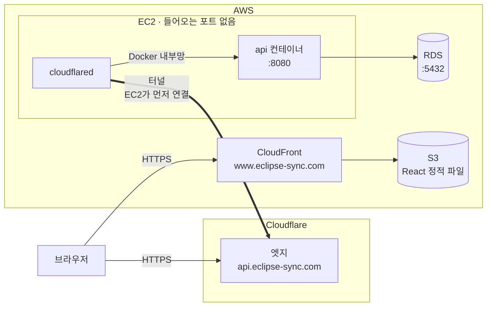

# 0001. 배포 구성: 화면·API 도메인 분리, Cloudflare Tunnel

- 날짜: 2026-11-14
- 작성: neru-33 (팀장)
- 상태: 제안 (PR 리뷰로 확정)
- 관련: #19 (Terraform 기본 자원), #41 (외부 접속 구성), #42 (CORS와 쿠키), T-49 (배포)

도메인은 `eclipse-sync.com`으로 결정하였다.

도메인 이름은 Terraform 변수와 API·프런트엔드의 환경 변수로 받고 코드에 직접 쓰지 않는다.

## 1. 화면과 API를 서로 다른 도메인으로 제공하고, API는 Cloudflare Tunnel로 받는다

**배경**: 연계 프로젝트는 CloudFront 하나가 화면(S3)과 API(EC2)를 같은 도메인으로 제공하고, CloudFront에서 EC2까지는 HTTP로 보낸다. 이 구간으로 세션 쿠키와 로그인 정보가 평문으로 오가는 문제가 있다.

**결정**

- `www.eclipse-sync.com`: CloudFront가 S3의 React 정적 파일을 제공한다.
- `api.eclipse-sync.com`: Cloudflare Tunnel로 받는다. EC2의 `cloudflared` 컨테이너가 Cloudflare로 먼저 연결해 터널을 만들고, 들어온 요청을 같은 Docker 네트워크의 api 컨테이너(`http://api:8080`)로 넘긴다.
- EC2는 들어오는 포트를 열지 않는다. api의 8080도 호스트에 열지 않는다.
- 같은 출처(same origin)는 유지하지 않는다. API는 CORS로 `www` 출처만 허용한다(5절).

```text
브라우저 ──HTTPS──▶ www → CloudFront ──▶ S3 (React 정적 파일)
브라우저 ──HTTPS──▶ api → Cloudflare ══터널══ EC2의 cloudflared ──▶ api 컨테이너:8080 ──▶ RDS:5432
```



**감수하는 점**

- Cloudflare에서 TLS가 끝나므로 API 요청 내용을 Cloudflare가 처리한다.
- Cloudflare나 `cloudflared`가 멈추면 API를 쓸 수 없다. `cloudflared` 컨테이너는 자동으로 다시 시작한다.

**대안**

| 대안 | 제외 이유 |
|---|---|
| CloudFront 하나로 화면과 API 제공 | 같은 출처라 CORS가 필요 없지만, CloudFront에서 EC2까지 평문으로 가거나, 이 구간을 암호화하려면 EC2에도 공인 인증서를 두어야 한다. |
| CloudFront VPC origin | EC2에 공인 IP가 없지만, 외부(GitHub API)로 나가려면 NAT가 필요해 비용이 늘어난다. |
| EC2를 직접 공개 (Caddy, Let's Encrypt) | 443과 80을 모든 주소에 열어야 하고, 인증서 갱신을 직접 챙겨야 한다. |
| EC2 앞에 ALB와 AWS WAF | ALB 비용이 예상 월 비용(`infra/README.md`)의 절반 가까이 된다. |
| Cloudflare 프록시 + 보안 그룹에서 Cloudflare 대역만 허용 | 대역을 모든 Cloudflare 고객이 같이 써서, 다른 계정을 거친 접속까지 막으려면 클라이언트 인증서를 따로 만들고 관리해야 한다. 터널은 들어오는 포트 없이 같은 보호를 얻는다. |

## 2. 인증서

| 구간 | 인증서 | 발급과 갱신 |
|---|---|---|
| 브라우저 → CloudFront (`www`) | ACM 공개 인증서, us-east-1 리전(CloudFront 요건) | Terraform이 만들고 확인용 CNAME을 Cloudflare에 등록한다. ACM이 자동 갱신 |
| 브라우저 → Cloudflare (`api`) | Cloudflare 엣지 인증서 | Cloudflare가 자동 발급·갱신 |
| Cloudflare → `cloudflared` | 없음 | 터널 토큰으로 인증하는 암호화 연결 |

EC2에는 인증서를 두지 않는다.

## 3. DNS와 Cloudflare 설정은 Terraform으로 관리한다

**결정**

- 도메인은 Cloudflare에서 구매했고 DNS도 Cloudflare가 맡는다. DNSSEC를 켠다. 무료 플랜을 쓴다.
- 터널, 공개 주소, DNS 레코드, 영역 설정, 요청 제한 규칙은 Terraform의 Cloudflare provider로 만들어 같은 구성을 다시 만들 수 있게 한다.
- 도메인 구매, DNSSEC 설정, Cloudflare API 토큰 발급은 Terraform 밖에서 하고 절차를 `infra/README.md`에 적는다.
- Cloudflare API 토큰에는 필요한 권한만 주고 환경 변수로 Terraform에 넘긴다. 저장소와 tfvars에는 넣지 않는다.

| 이름 | 종류 | 값 | 프록시 |
|---|---|---|---|
| `www` | CNAME | CloudFront 배포 주소 | 끔 |
| `api` | CNAME | `<터널 ID>.cfargotunnel.com` | 켬 (터널은 프록시가 켜져 있어야 동작한다) |
| ACM 확인용 이름 | CNAME | ACM이 알려 주는 값 | 끔 |

| 설정 | 값 |
|---|---|
| Always Use HTTPS | 켬 |
| 요청 제한 규칙 (무료 1개) | `POST /auth/admin/login`에 IP당 10초 10회를 넘으면 10초 차단 |

## 4. EC2 보안 그룹

| 방향 | 포트 | 대상 | 용도 |
|---|---|---|---|
| 들어옴 | 없음 | 없음 | 터널은 EC2가 먼저 연결한다. 관리 접속은 Session Manager |
| 나감 | 전체 | 0.0.0.0/0 | Cloudflare 터널, GitHub API, AWS 서비스, RDS, 이미지 저장소 |

- DNS가 EC2 IP를 가리키지 않으므로 고정 IP(EIP)는 두지 않는다. 공인 IP는 밖으로 나갈 때만 쓴다.
- 터널 토큰은 Parameter Store(SecureString)에 두고, 배포 스크립트가 `cloudflared`에 넘긴다.
- api는 `CF-Connecting-IP` 헤더를 사용자 IP로 쓴다. 터널 말고는 api로 들어올 길이 없어야 하므로 8080을 호스트에 열지 않는다.
- RDS 보안 그룹은 EC2 보안 그룹에서 오는 5432만 받는다.

## 5. CORS, 쿠키, CSRF

- 허용 출처는 `https://www.eclipse-sync.com` 하나이고 환경 변수로 받는다. 와일드카드(`*.eclipse-sync.com`)는 쓰지 않는다.
- 요청의 `Origin`이 허용 출처와 정확히 같을 때만 그 값을 `Access-Control-Allow-Origin`으로 응답하고, `Access-Control-Allow-Credentials: true`와 `Vary: Origin`을 붙인다. 허용 헤더는 `Content-Type`, `X-CSRF-Token`이다.
- 쓰기 요청 앞에 오는 사전 요청(OPTIONS)은 쿠키 없이 오므로, 로그인 검사보다 먼저 CORS 처리에서 응답한다.
- 세션 쿠키는 `api` 호스트 전용이고 `Secure`, `HttpOnly`, `SameSite=Lax`다. `www`와 `api`는 같은 사이트라 `Lax`로도 쿠키가 실린다.
- CSRF는 공통 인증(#23)의 `X-CSRF-Token` 헤더 방식을 그대로 쓴다.

## 6. 영향 범위

| 대상 | 바꿀 내용 |
|---|---|
| Terraform 기본 자원 (#19) | CloudFront 대역 80 규칙과 `allow_cloudfront_origin` 변수 삭제 |
| 외부 접속 구성 (#41) | Cloudflare provider와 Cloudflare 자원, `cloudflared` 컨테이너, 터널 토큰용 Parameter Store 항목, EIP 제거, CloudFront와 웹 버킷, ACM 인증서, React Router 주소 새로고침 처리 |
| 백엔드 API (#42) | CORS, 운영 세션 쿠키 `Secure`, 로그인 후 `www`로 이동, `CF-Connecting-IP`를 사용자 IP로 사용 |
| 프런트엔드 | 배포 빌드의 `VITE_API_BASE_URL`을 `https://api.eclipse-sync.com`으로 설정 |
| GitHub App | Callback URL을 `https://api.eclipse-sync.com/auth/github/callback`으로 설정 |
| 문서 | `docs/github-app.md`의 Callback URL, `infra/README.md`의 Cloudflare 준비 절차와 터널 토큰 넣는 방법 |

Webhook 수신 경로(GitHub → API Gateway → Lambda)는 이 결정의 영향을 받지 않는다.
