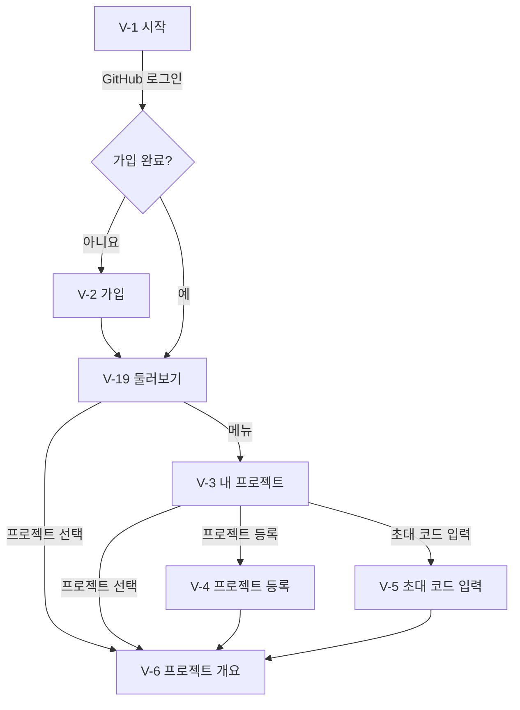
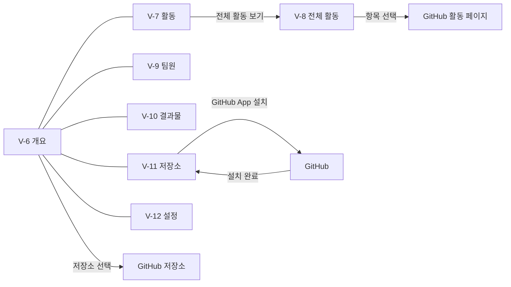
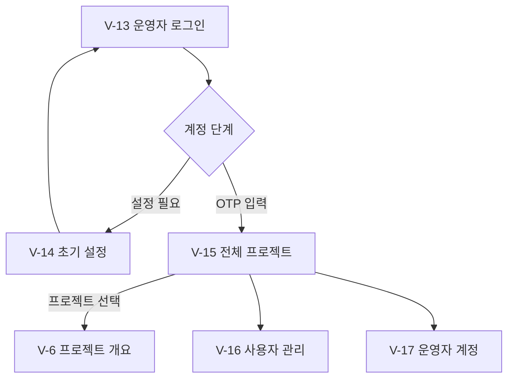

# 화면 흐름

이 문서는 RepoScope의 화면 구성과 이동 경로를 정한다. 색, 글꼴, 배치 같은 시각 디자인은 다루지 않는다. 기능 번호는 [기능 명세](feature-spec.md)를 따른다.

## 1. 화면 목록

주소는 서비스 기준 경로다. 배포 환경에 따라 앞에 기본 경로가 붙을 수 있다.

| 번호 | 화면 | 주소 | 접근 | 유형 | 기능 |
|---|---|---|---|---|---|
| V-1 | 시작 | `/` | 모두 | 안내 | R-1 |
| V-2 | 가입 | `/signup` | `GUEST` | 입력 | R-1 |
| V-3 | 내 프로젝트 | `/projects` | `STUDENT` | 목록 | R-3, R-9 |
| V-4 | 프로젝트 등록 | `/projects/new` | `STUDENT` | 입력 | R-3 |
| V-5 | 초대 코드 입력 | `/join` | `STUDENT` | 입력 | R-4 |
| V-6 | 프로젝트 개요 | `/projects/:id` | 공개 조회 권한 | 상세 | R-3, R-5, R-7 |
| V-7 | 활동 | `/projects/:id/activity` | 공개 조회 권한 | 대시보드 | R-8, R-9 |
| V-8 | 전체 활동 | `/projects/:id/activity/all` | 공개 조회 권한 | 목록 | R-8 |
| V-9 | 팀원 | `/projects/:id/members` | 프로젝트 조회 권한 | 목록 | R-4 |
| V-10 | 결과물 | `/projects/:id/deliverables` | 프로젝트 조회 권한 | 목록 | R-6 |
| V-11 | 저장소 | `/projects/:id/repos` | 프로젝트 조회 권한 | 목록 | R-7 |
| V-12 | 프로젝트 설정 | `/projects/:id/settings` | 팀장, 운영자 | 입력 | R-3 |
| V-13 | 운영자 로그인 | `/admin/login` | 모두 | 입력 | R-2 |
| V-14 | 운영자 초기 설정 | `/admin/setup` | 설정 단계 운영자 | 입력 | R-2 |
| V-15 | 전체 프로젝트 | `/admin/projects` | `SUPER_ADMIN`, `ADMIN`, `PROFESSOR` | 목록 | R-3 |
| V-16 | 사용자 관리 | `/admin/users` | `SUPER_ADMIN`, `ADMIN` | 목록 | R-10 |
| V-17 | 운영자 계정 | `/admin/operators` | `SUPER_ADMIN` | 목록 | R-2 |
| V-18 | 오류 | 없음 | 모두 | 안내 | 공통 |
| V-19 | 둘러보기 | `/explore` | `STUDENT` | 목록 | R-3, R-9 |

- 프로젝트 조회 권한: 팀원, `PROFESSOR`, `SUPER_ADMIN`, `ADMIN`
- 공개 조회 권한: 프로젝트 조회 권한에 더해, 공개 범위가 `학생 모두`이면 다른 팀 학생

## 2. 로그인 후 이동

| 사용자 상태 | 이동 화면 |
|---|---|
| 로그인하지 않음 | V-1 |
| `GUEST` | V-2 |
| `STUDENT` | V-19 |
| 설정 단계 운영자 | V-14 |
| `SUPER_ADMIN`, `ADMIN`, `PROFESSOR` | V-15 |

로그인이 필요한 화면을 주소로 바로 열면 로그인 뒤 그 화면으로 돌아온다. 세션이 만료되면 학생은 V-1, 운영자는 V-13으로 이동한다.

## 3. 메뉴

| 사용자 | 상단 메뉴 |
|---|---|
| `STUDENT` | 둘러보기, 내 프로젝트, 로그아웃 |
| `PROFESSOR` | 전체 프로젝트, 로그아웃 |
| `ADMIN` | 전체 프로젝트, 사용자 관리, 로그아웃 |
| `SUPER_ADMIN` | 전체 프로젝트, 사용자 관리, 운영자 계정, 로그아웃 |

프로젝트 안에서는 개요, 활동, 팀원, 결과물, 저장소 탭을 공통으로 쓴다. 팀장과 운영자에게는 설정 탭을 추가로 표시한다. 공개 프로젝트를 보는 다른 팀 학생에게는 개요와 활동 탭만 표시한다.

## 4. 이동 경로

### 학생

### 프로젝트

### 운영자

## 5. 화면별 내용

### 시작과 가입

| 화면 | 표시 내용 | 주요 동작 |
|---|---|---|
| V-1 시작 | 서비스 소개, 수집 범위 안내 | GitHub 로그인 |
| V-2 가입 | 학번, 이름, 학과 입력란, 개인정보 수집·이용 안내 | 동의 후 가입 완료 |
| V-4 프로젝트 등록 | 이름, 팀 이름, 설명, 시작일, 종료일, 공개 범위와 설명, 목록 카드 미리보기 | 등록 |
| V-5 초대 코드 입력 | 코드 입력란 | 코드 확인 후 프로젝트 참여 |

### 프로젝트 목록

| 화면 | 표시 내용 | 주요 동작 | 빈 상태 |
|---|---|---|---|
| V-3 내 프로젝트 | 카드: 진행 단계, 프로젝트 이름, 팀 이름, 설명, 최근 16주 활동, 내 역할, 팀원 수, 마지막 활동일 | 진행 중·완료·보관 구분, 프로젝트 등록, 초대 코드 입력, 프로젝트 선택 | 프로젝트 등록과 초대 코드 입력 안내 |
| V-19 둘러보기 | 줄 목록: 프로젝트 이름, 팀 이름, 팀장, 팀원 수, 설명, 진행 단계, 최근 16주 활동, 마지막 활동일, 내 프로젝트 표시 | 이름·팀 이름·설명 검색, 진행 상태 필터, 정렬(최근 활동순, 이름순, 최근 등록순), 프로젝트 선택 | 공개된 프로젝트 없음 안내 |
| V-15 전체 프로젝트 | 프로젝트 이름, 팀장, 팀원 수, 진행 상태, 마지막 활동일 | 이름 검색, 진행 상태 필터, 보관 포함 조회, 프로젝트 선택 | 등록된 프로젝트 없음 안내 |

### 프로젝트 안

| 화면 | 표시 내용 | 주요 동작 | 빈 상태 |
|---|---|---|---|
| V-6 개요 | 대표 저장소 README, 프로젝트 정보(팀, 팀장, 기간, 공개 범위, 연결 저장소), 팀원(팀장 먼저, 프로필 사진), 최근 결과물 | 진행 상태 변경, 상태 이력 보기, 저장소를 GitHub에서 열기 | README가 없으면 설명과 안내, 저장소가 없으면 연결 안내 |
| V-7 활동 | 1단계 숫자, 주간 활동 추이, 팀원별 활동 표, 최근 활동 5개, 집계 안내 | 기간 선택, 전체 활동 보기 | 저장소가 없으면 연결 안내, 수집 중이면 진행 안내, 활동 없음 안내 |
| V-8 전체 활동 | 종류, 제목, 작성자, 저장소, 시각 | 기간·종류·작성자·저장소 필터, GitHub로 이동 | 조건에 맞는 활동 없음 안내 |
| V-9 팀원 | 이름, 학번, GitHub 로그인 이름, 역할 | 초대 코드 발급, 역할 변경, 팀원 제외 | 초대 코드 발급 안내 |
| V-10 결과물 | 종류, 제목, 등록자, 등록일, 링크 | 등록, 수정, 삭제 | 결과물 등록 안내 |
| V-11 저장소 | 저장소 이름, 공개 여부, 수집 상태, 마지막 수집 시각, 수집 중단 방법 안내 | GitHub App 설치, 연결, 연결 해제 | GitHub App 설치 안내 |
| V-12 설정 | 프로젝트 이름, 팀 이름, 설명, 시작일, 종료일, 공개 범위, 대표 저장소 | 수정, 보관 | 없음 |

권한이 없는 동작의 버튼은 표시하지 않는다. 보관한 프로젝트와 다른 팀의 공개 프로젝트는 모든 탭을 읽기 전용으로 표시한다. 다른 팀 학생에게는 개요의 최근 결과물을 표시하지 않는다.

### 운영자

| 화면 | 표시 내용 | 주요 동작 |
|---|---|---|
| V-13 운영자 로그인 | ID, 비밀번호, OTP 입력란 | 로그인 |
| V-14 초기 설정 | 새 ID, 새 비밀번호, OTP QR 코드 | 비밀번호 변경, OTP 등록 |
| V-16 사용자 관리 | 이름, 학번, 학과, GitHub 로그인 이름, 직위, 상태 | 검색, 정보 수정, 비활성화 |
| V-17 운영자 계정 | ID, 직위, 계정 단계, 상태 | 계정 발급, 비밀번호·OTP 초기화, 비활성화 |

## 6. 공통 상태

| 상태 | 표시 |
|---|---|
| 불러오는 중 | 화면 틀을 유지하고 내용 영역에 로딩 표시 |
| 권한 없음 | V-18에 권한이 없다는 안내와 이전 화면 이동 버튼 표시 |
| 없는 주소 | V-18에 찾을 수 없다는 안내와 첫 화면 이동 버튼 표시 |
| 서버 오류 | 다시 시도 버튼 표시 |
| 입력 오류 | 해당 입력란 아래에 고칠 내용 표시 |
| 저장 성공 | 짧은 완료 메시지 표시 |
| 위험한 동작 | 보관, 연결 해제, 팀원 제외, 비활성화 전에 확인 대화상자 표시 |

## 7. 시연 흐름

1. 학생이 V-1에서 로그인하고 V-2에서 가입한다. 가입이 끝나면 V-19로 이동한다.
2. V-4에서 공개 범위를 `학생 모두`로 정해 프로젝트를 등록한다.
3. V-9에서 초대 코드를 발급하고, 다른 학생이 V-5에서 참여한다.
4. V-11에서 GitHub App을 설치하고 저장소를 연결한다.
5. V-6에서 대표 저장소의 README를 확인하고, V-7에서 통계와 최근 활동을, V-8에서 전체 활동을 조회한다.
6. V-10에서 결과물을 등록하고 V-6에서 진행 상태를 바꾼다.
7. 다른 팀 학생이 V-19에서 프로젝트를 찾아 개요와 활동을 본다.
8. 운영자가 V-13으로 로그인해 V-15에서 프로젝트를 확인한다.
