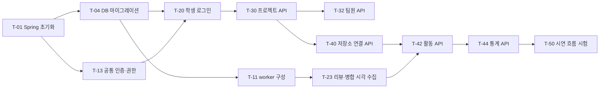

# 작업 계획

이 문서는 제출 버전을 완성하기 위한 작업 순서와 선행 관계를 정한다. 작업의 완료 조건은 [기능 명세](feature-spec.md)를 따르고, 구현 기준은 [화면 흐름](screen-flow.md), [데이터 모델](data-model.md), [API 명세](api-spec.md)다.

## 1. 일정

단계는 매주 목요일 정기 모임을 기준으로 나눈다.

| 단계 | 기간 | 목표 | 정기 모임에서 확인할 것 |
|---|---|---|---|
| 1. 기반 구성 | 11/7~11/12 | 프로젝트 초기화, DB, 공통 인증, 수집 코드 준비 | 로컬에서 API, 화면, DB가 함께 실행된다 |
| 2. 핵심 기능 | 11/13~11/19 | 로그인, 프로젝트, 팀원, 진행 상태, 결과물, 수집 동작 | 프로젝트 등록부터 팀원 참여까지 동작한다 |
| 3. GitHub 연동 | 11/20~11/26 | 저장소 연결, 활동, 통계, 운영자 기능, AWS 배포 | AWS에서 시연 흐름이 끝까지 동작한다 |
| 4. 검증과 정리 | 11/27~11/30 | 시험, 안내서, 시연 자료 | 제출물이 모두 준비된다 |

## 2. 담당 영역

담당자는 이슈에서 지정한다. 영역은 저장소 라벨과 같다.

| 영역 | 라벨 | 범위 | 폴더 |
|---|---|---|---|
| 프런트엔드 | `frontend` | React 화면 | `frontend/` |
| 백엔드 | `backend` | Spring API, 인증, 프로젝트 기능 | `backend/api/` |
| 수집 | `backend`, `webhook` | worker, 수신 Lambda | `backend/worker/`, `backend/migrations/`, `webhook/` |
| 인프라 | `infra` | AWS, 컨테이너, CI/CD | `infra/` |

## 3. 진행 원칙

- 작업 하나가 이슈 하나다. 브랜치와 PR은 [기여 규칙](../CONTRIBUTING.md)을 따른다.
- 프런트엔드는 API를 기다리지 않는다. API 명세의 예시 응답으로 화면을 먼저 만들고, API가 나오면 연결한다.
- 백엔드는 T-13이 끝나면 기능별로 나눠 병렬로 진행한다.
- 수집 코드는 연계 프로젝트의 구현을 가능한 범위에서 재사용한다. 구현이 달라지거나 확장되는 부분은 입출력 계약을 지켜 다시 구현한다.
- AWS 자원은 Terraform으로 만든다. 연계 프로젝트의 모듈을 재사용하되 자원 이름과 비밀값 경로는 RepoScope 값으로 바꾸고, 재사용한 출처를 기록한다.
- `terraform apply`는 인프라 담당만 실행한다.
- 로컬 실행 환경은 두 가지로 나눈다. 기본 구성은 PostgreSQL, API, 화면이고 모든 팀원이 쓴다. 수집 구성은 기본 구성에 `moto`, 수신 함수, worker를 더한 것이고 수집과 인프라 담당이 쓴다.
- 작업이 막히면 이슈에 이유를 적고 정기 모임 전에 공유한다.

## 4. 선행 관계

이 경로가 늦어지면 전체 일정이 늦어진다. 정기 모임에서 가장 먼저 확인한다.

## 5. 작업 목록

### 1단계 기반 구성

| 번호 | 작업 | 라벨 | 기능 | 선행 |
|---|---|---|---|---|
| T-01 | Spring 프로젝트 초기화, 상태 확인 API, Dockerfile | `backend` | 공통 | 없음 |
| T-02 | React 프로젝트 초기화, 라우팅, API 클라이언트 | `frontend` | 공통 | 없음 |
| T-03 | 로컬 실행 환경 구성(기본, 수집), 개발 환경 안내 작성 | `infra` | 공통 | 없음 |
| T-04 | DB 마이그레이션 작성 | `backend` | 데이터 모델 | T-01 |
| T-05 | CI 구성 | `infra` | 공통 | T-01, T-02 |
| T-06 | 시연용 GitHub App 등록 | `infra` | S-1 | 없음 |
| T-07 | UI 라이브러리와 화면 기준 결정 | `frontend` | 공통 | 없음 |
| T-08 | 공통 레이아웃, 메뉴, 오류 화면 | `frontend` | V-18 | T-02, T-07 |
| T-09 | Terraform으로 AWS 기본 자원 구성 | `infra` | S-1, S-2 | 없음 |
| T-10 | Webhook 수신 Lambda 구성 | `webhook` | S-1 | T-03, T-06 |
| T-11 | worker 구성 | `backend` | S-2 | T-04 |
| T-12 | 수신에서 저장까지 로컬 시험(`moto`) | `webhook`, `backend` | S-1, S-2 | T-10, T-11 |
| T-13 | 공통 인증·권한, CSRF, 오류 응답 | `backend` | 공통 규칙 | T-01 |

### 2단계 핵심 기능

| 번호 | 작업 | 라벨 | 기능 | 선행 |
|---|---|---|---|---|
| T-20 | 학생 로그인과 가입 API | `backend` | R-1 | T-04, T-06, T-13 |
| T-21 | 시작, 가입 화면 | `frontend` | R-1, V-1, V-2 | T-08 |
| T-22 | 과거 기록 가져오기 | `backend` | S-3 | T-11 |
| T-23 | 리뷰와 병합 시각 수집 | `backend`, `webhook` | S-1, S-2 | T-11 |
| T-24 | 운영자 로그인 API | `backend` | R-2 | T-04, T-13 |
| T-25 | 운영자 로그인, 초기 설정 화면 | `frontend` | R-2, V-13, V-14 | T-08 |
| T-30 | 프로젝트 API | `backend` | R-3 | T-20 |
| T-31 | 프로젝트 목록, 등록, 개요, 설정 화면 | `frontend` | R-3, V-3, V-4, V-6, V-12 | T-08 |
| T-32 | 팀원과 초대 코드 API | `backend` | R-4 | T-30 |
| T-33 | 초대 코드 입력, 팀원 화면 | `frontend` | R-4, V-5, V-9 | T-08 |
| T-34 | 진행 상태 API와 화면 | `backend`, `frontend` | R-5, V-6 | T-30, T-31 |
| T-35 | 결과물 API | `backend` | R-6 | T-30 |
| T-36 | 결과물 화면 | `frontend` | R-6, V-10 | T-08 |

### 3단계 GitHub 연동

| 번호 | 작업 | 라벨 | 기능 | 선행 |
|---|---|---|---|---|
| T-40 | 저장소 연결 API | `backend` | R-7 | T-30, T-22 |
| T-41 | 저장소 화면 | `frontend` | R-7, V-11 | T-08 |
| T-42 | 활동 API | `backend` | R-8 | T-40, T-23 |
| T-43 | 활동 화면 | `frontend` | R-8, V-7 | T-08 |
| T-44 | 통계 API | `backend` | R-9 | T-42 |
| T-45 | 통계 화면 | `frontend` | R-9, V-6, V-8 | T-08 |
| T-46 | 누락 복구 | `backend` | S-3 | T-22 |
| T-47 | 전체 프로젝트, 사용자 관리 | `backend`, `frontend` | R-3, R-10, V-15, V-16 | T-24, T-30 |
| T-48 | 운영자 계정 관리 | `backend`, `frontend` | R-2, V-17 | T-24 |
| T-49 | Terraform으로 AWS 배포, CD 구성 | `infra` | 공통 | T-05, T-09, T-10 |

### 4단계 검증과 정리

| 번호 | 작업 | 라벨 | 기능 | 선행 |
|---|---|---|---|---|
| T-50 | 시연 흐름 시험 | 전체 | 시연 흐름 | T-44, T-45, T-49 |
| T-51 | 권한, 이벤트 중복, 누락 복구, 연결 해제 시험 | 전체 | 완료 조건 | T-46, T-49 |
| T-52 | 시험 결과와 한계 정리 | 전체 | 제출물 | T-50, T-51 |
| T-53 | 사용자·운영자 안내서 작성 | 전체 | 제출물 | T-50 |
| T-54 | 운영 문서 작성 | `infra` | R-2, 제출물 | T-49 |
| T-55 | 시연 자료와 결과보고서 작성 | 전체 | 제출물 | T-52 |

## 6. 일정이 부족할 때

아래 순서로 범위를 줄인다. 시연 흐름에 직접 필요한 기능은 줄이지 않는다.

1. 여유 시 기능 R-11~R-13을 시작하지 않는다.
2. 운영자 계정 관리 화면 T-48은 초기 계정 설정과 API로 대체한다.
3. 사용자 관리 화면 T-47의 검색과 학과 수정을 뺀다.
4. 프로젝트 설정 화면 V-12의 일정 수정을 뺀다.
5. 통계는 프로젝트별 숫자와 팀원별 표를 먼저 완성하고, 주간 추이를 마지막에 넣는다.

## 7. 이슈 작성 방법

- 제목은 `[기능] 프로젝트 API`, `[작업] CI 구성`처럼 쓴다.
- 본문에는 작업 번호, 관련 기능 번호, 선행 작업을 적는다.
- 완료 조건은 기능 명세의 항목을 그대로 옮긴다.
- 영역 라벨을 붙이고 단계별 마일스톤에 넣는다.
